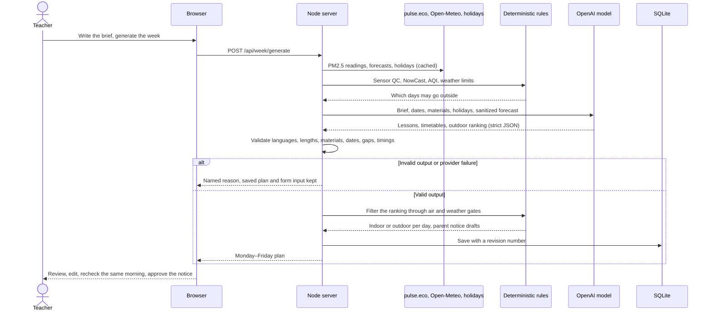
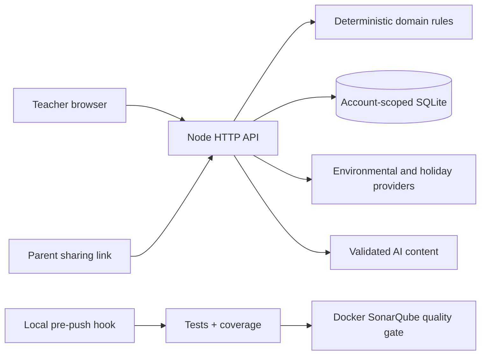

<div align="center">
  
  <h1>Неделко · Nedelko</h1>
  <p>Вашата недела во градинка, испланирана. / Your kindergarten week, planned.</p>
  <p><strong>For kindergarten teachers in Skopje and other Macedonian cities,<br>with a read-only family view for parents.</strong></p>
  <p><a href="demo.mp4"><strong>▶ Watch the demo video (demo.mp4, 9 min)</strong></a></p>
  <p><a href="#what-it-does">What it does</a> · <a href="#who-it-is-for">Who it is for</a> · <a href="#how-to-run-it">How to run it</a> · <a href="#see-it-working">Demo</a> · <a href="#how-the-ai-works">How the AI works</a> · <a href="#what-is-finished-and-what-is-not">Finished and not</a> · <a href="#what-we-would-build-next">Next</a> · <a href="#how-we-built-it">How we built it</a> · <a href="#does-it-hold-up">Tests</a></p>
</div>

---

## What it does

Nedelko plans a kindergarten group's Monday–Friday week in Macedonian and English: an AI model turns the teacher's written brief into daily lessons, each with an indoor and an outdoor version, and a complete timetable for every day. Deterministic checks of local PM2.5 readings and weather forecasts choose which version runs each day, and parents see the week through a read-only link.

**Неделко** е приспособлива веб-апликација за воспитувачи и родители, на македонски и англиски, подготвена и тестирана на телефон и компјутер.

## Who it is for

**Kindergarten teachers** in Skopje and other supported Macedonian cities. Each week a teacher plans activities for one group around meals and rest, decides whether the children can go outside, and keeps parents informed. Air pollution and weather can change the outdoor decision after the plan is written. Nedelko puts the lessons, timetable, air readings, forecasts and holidays into one plan and rechecks it every minute.

**Parents** open a link from the teacher, see the day's activity and whether it runs inside or outside, and can send the teacher a private note. They need no account.

### What a teacher told us

The product owner reports a pilot session with a practising kindergarten teacher. In the owner's account, the teacher found Nedelko interesting and promising, liked the AI's suggestions for a whole week, and expected the combined weather, air-pollution and holiday information to save planning time. This is an attributed paraphrase of one session, not a verbatim quotation, a study or a measured time saving. See [pilot feedback and proposed research](docs/product/research.md).

### How it fits the theme

- **Be helpful:** one named user, the kindergarten teacher, and one weekly job: plan the week and tell parents what changed.
- **For the community:** the interface and parent notices are in Macedonian and English, the parent page works on a phone without an account, and anyone can try a sample week without signing up.
- **Go green:** lessons draw on ecology, reuse, reducing waste and the season where they fit the teacher's brief, and outdoor time is planned around local air pollution. This is environmental education; we do not claim measured waste or energy savings.

## How to run it

Requires **Node.js 24+**. Running the app needs no `npm install` and no build step. In Windows PowerShell, use `npm.cmd` if the execution policy blocks `npm`.

### 1. Try a sample week (no account, no API key)

```sh
npm start
```

Open **[127.0.0.1:4173](http://127.0.0.1:4173)** and choose **Explore a sample week**. Sample weeks use synthetic conditions and the built-in lesson library; they never call the AI.

### 2. Create a real plan (needs an OpenAI API key)

```sh
cp .env.example .env   # only if .env does not exist yet (Windows: copy .env.example .env)
# set OPENAI_API_KEY in .env; OPENAI_MODEL and OPENAI_SERVICE_TIER are pre-filled
npm start
```

Register a kindergarten (kindergarten name, teacher name, age group and location), write the week's brief and generate the plan. A real account needs a working model: if the key is missing or the call fails, Nedelko shows the reason and keeps the saved plan instead of substituting an unrelated library week. The example sets `OPENAI_SERVICE_TIER=fast`, which has premium pricing; `default` selects standard processing. The key stays on the server. Restart after editing `.env`, and preserve an existing `.env`.

### 3. Or run it with Docker

Requires Docker Engine/Desktop with Compose v2.24+. Compose reads the same `.env`.

```sh
docker compose up --build -d --wait   # app on 127.0.0.1:4173, SQLite in the app_data volume
docker compose down                   # stop; named volumes remain
```

See [Docker operation](docs/operations/docker.md) for ports, resources and backups.

### 4. Run the checks

```sh
npm ci            # installs test tooling only
npm test          # domain, API, SQLite, DOM and tooling tests
npm run verify    # syntax, documentation links, tests, ≥91% line coverage for backend and frontend
npm run test:api  # Postman API collection; first run: npm --prefix api-tests ci
```

Contributors run `npm run hooks:install` once per clone. The pre-push hook runs `npm run gate`: local checks, tests, coverage and a completed, passing SonarQube quality gate. SonarQube runs in its own Docker stack; follow the [quality gates guide](docs/development/quality-gates.md) to set it up. `npm run dev` restarts the server on source changes. `npm run verify:ai` makes one deliberate, paid live-model request and writes [sanitized evidence](docs/evidence/README.md); normal tests never call it.

## See it working

- **Demo video:** [▶ Watch demo.mp4](demo.mp4), a 9-minute walkthrough of the application, added on 22 September 2026. GitHub opens it in the file viewer; use **View raw** or **Download** if it does not play inline.
- **Backup recording:** [demo.webm](docs/evidence/demo-2026-09-21/demo.webm) (1:55, 21 September 2026) shows the sample week, parent sharing, one real AI generation, synthetic pollution moving a lesson indoors, and 390-pixel phone views. Its [record](docs/evidence/demo-2026-09-21/smoke-summary.json) names the source commit and the synthetic inputs.

### One path from start to finish

1. Run `npm start`, open [127.0.0.1:4173](http://127.0.0.1:4173) and choose **Explore a sample week**.
2. Home shows the Monday–Friday week, the current air card and each day's indoor or outdoor choice. Select an activity to read it in Macedonian or English.
3. Use **Change activity** to replace one activity. In the sample week, suggestions come from the local library.
4. Choose **Create parent link**, then **Preview as a parent**, and keep that tab open.
5. In the teacher tab, set **Monday air conditions** to **Polluted morning**. The lesson moves indoors; the parent page follows within a minute, or immediately after a reload.
6. Use **Recheck conditions**, then **Approve message** for the day's parent notice, and copy it into your usual channel.

With an API key, the same flow works in a real account with an AI-generated plan and live data.

### What is real and what is synthetic

| Part | Sample week | Real account |
| --- | --- | --- |
| Lessons and timetable | Built-in library, no AI | Generated by the configured OpenAI model, validated by the server |
| PM2.5 readings | Synthetic scenarios on a fixed clock | Live pulse.eco sensors within 5 km, cached with their original measurement time |
| Weather and air forecasts | Synthetic | Live Open-Meteo and CAMS Europe forecasts; a forecast is not an observation |
| Holidays | Dated snapshot | Official announcements, with a sourced 2026 snapshot as fallback |
| Parent notices | Deterministic templates, copied by the teacher | The same; Nedelko sends no email, SMS or push messages |

The recorded [live model run](docs/evidence/live-ai-2026-09-21.json) on 21 September 2026 used `gpt-5.6-terra` and returned `source: ai`. It used synthetic air and weather, so it verifies the model call, not the live environmental providers. The [evidence index](docs/evidence/README.md) keeps these separate.

## How the AI works

A fixed library cannot interpret a teacher's brief, so real accounts reject a failed generation instead of saving an unrelated example week. The model does three jobs. Each request uses a strict JSON schema, and the server checks every answer before it is saved or shown.

| Job | Messy input it reads | What the model returns | What happens next |
| --- | --- | --- | --- |
| Plan the week | The teacher's free-text brief (up to 2,000 characters, Macedonian or English), dates, chosen materials, holidays and a sanitized forecast summary | Five bilingual lessons with indoor and outdoor versions, a complete timetable for each day, and a ranking of the best outdoor days | Server validation; deterministic air and weather gates choose the outdoor days; templates build parent notices |
| Change an activity or a day | The teacher's request in their own words | A revised activity or a revised day timetable | Validated and applied on submit; later rows shift to resolve overlaps; started activities stay locked |
| Read a parent note | A parent's free-text note | Whether it is information for the teacher or a group change request, with a bilingual explanation | An actionable note can trigger a second model call that drafts the change; the teacher previews it and chooses Apply |

The parent-note flow is a two-step chain: one call classifies the note, another drafts the timetable change, and the teacher decides. The model does not call tools. The server fetches readings, forecasts and holidays first, applies the deterministic rules, and sends the model only a sanitized summary.

### From the teacher's click to a saved plan



### When the AI is confidently wrong

- **Shape and content checks.** After the strict schema, the server checks both languages, length limits, the teacher's chosen materials, every date exactly once, a timetable row for every minute of the day, and clear timing requests after overlaps are resolved. It also rejects selected markup, instruction and air-safety patterns.
- **The ranking is advice, not permission.** The model ranks days for outdoor learning; the air and weather gates skip a day that fails, even when the model ranked it first.
- **Facts stay deterministic.** The model never computes AQI, sees raw sensor values, decides closures or writes the air and weather wording of parent notices.
- **Failures are named, not hidden.** Credit, quota, rate-limit, authentication, model-availability and timeout failures each report their own reason. When a browser disconnects, the model call is cancelled and a late answer is discarded.
- **The teacher decides.** Every lesson stays editable, parent-note suggestions need an explicit Apply, and a parent notice becomes approvable only after a same-morning recheck.
- **What validation cannot show.** A valid lesson is not necessarily a good one. We have not measured lesson quality; see [what we would build next](#what-we-would-build-next).

Model input excludes account IDs, kindergarten and group names, raw sensor readings and AQI values. Teachers are asked to leave child names and private details out of the brief; the app does not anonymise that text automatically.

## What is finished and what is not

### Finished

- Kindergarten accounts with email and password, and private SQLite-backed plans; one group per account.
- AI weekly plans from the teacher's brief, AI changes to one activity or a whole day, direct edits, drag-and-drop reordering, and a per-day **Inside**, **Outside** or **Adapt to conditions** choice.
- Deterministic PM2.5 quality control, NowCast and AQI, editable weather limits, and a server worker that rechecks active weeks every minute.
- A read-only, printable parent page in both languages, revocable links that expire after 14 days, private parent notes with a teacher inbox, and AI suggestions from those notes.
- A same-morning recheck that makes the day's parent notice approvable for 15 minutes; refreshes and edits cancel the approval.
- Six synthetic sample weeks (Independence Day, Easter, Halloween, winter, an autumn afternoon and a spring garden), each with six air scenarios.
- Phone and desktop layouts, a Docker setup, automated tests, coverage floors and a local SonarQube gate.

### Not finished, and known issues

- **Runs on one computer.** The app serves plain HTTP on loopback, so parent links open only on that computer. HTTPS hosting, account recovery and hosted backups are separate work.
- **No delivery.** Teachers copy notices into their usual channel; Nedelko does not send them.
- **A link is not an identity.** Anyone holding an active parent link can view the shared week and submit a private note.
- **PM2.5 only.** Screening omits other pollutants and individual health needs. It is not a complete air-quality assessment or a medical certification. A future outdoor day needs a complete air forecast; otherwise it stays indoors and provisional. Weather limits are editable logistics preferences, not health or safety thresholds.
- **Live data can fail.** Observations come from pulse.eco and forecasts from Open-Meteo. Missing, stale, suspect or conflicting data counts as unknown, never as clean air, and a failed refresh cannot renew approval.
- **AI costs money, and its quality is unmeasured.** Real plans need a working OpenAI key. Educators have not rated the generated lessons.
- **Rate limits reset on restart.** They are held in process memory.
- **Not yet verified:** a fresh-machine install by someone outside the team, a teammate's separate GitHub access, and use beyond the single pilot session. The [verification record](docs/development/verification-status.md) separates current results from historical checks.

## What we would build next

With another week, in this order:

1. **Host a small pilot** over HTTPS with backups and monitoring, so parent links work on parents' own phones.
2. **Measure AI quality** with a set of 40 synthetic briefs (both languages, age bands, limited materials, winter and rain, holidays, day edits), rated by an educator for fit, age suitability and preparation effort.
3. **Talk to more teachers and parents** before adding features. Observe how they plan and share changes today, then start the proposed four-week pilot with one kindergarten, two educators and about 8–12 families.
4. **Add version history and undo**, plus a short change notice with delivery preferences.

The reasoning and proposed success measures are in [product research](docs/product/research.md).

## How we built it

### Structure

```text
frontend/         Preact + HTM browser app: pages, components, locales, styles, pinned vendor files, DOM tests
backend/
  domain/         pure rules: sensor QC and AQI, week planning, timetables, notices, parent view
  services/       pulse.eco, Open-Meteo, holiday import, OpenAI client, authentication, background refresh
  http/           routes, origin checks, rate and body limits
  storage/        SQLite accounts, sessions, weeks, profiles, parent links and notes
  tests/          domain, API, authentication, storage and model-boundary tests
api-tests/        Postman collection and runner
static-analysis/  SonarQube stack and scanner configuration
docs/             architecture, ADRs, decision rules, operation, evidence
```



The [architecture overview](docs/architecture/overview.md) walks through each module.

### Why these tools

| Choice | Why | Record |
| --- | --- | --- |
| Native Node HTTP, `crypto` and built-in `node:sqlite` | No server runtime dependencies; one command starts the app | [ADR-0001](docs/architecture/adrs/0001-native-node-and-preact.md), [ADR-0006](docs/architecture/adrs/0006-sqlite-application-database.md) |
| Preact 10.29.8 + HTM 3.1.1 as pinned local files | Components without a bundler, CDN or build step | [ADR-0001](docs/architecture/adrs/0001-native-node-and-preact.md) |
| Rules in code, content from the model | Air arithmetic, timestamps and permissions must be reproducible and testable; model output is untrusted | [ADR-0002](docs/architecture/adrs/0002-deterministic-evidence-boundaries.md) |
| The teacher's instructions come first | The brief overrides default routines and holiday ideas; a failed generation never saves an unrelated plan | [ADR-0012](docs/architecture/adrs/0012-teacher-instruction-priority.md) |
| A local pre-push gate | Tests, coverage floors and a SonarQube gate run before a push | [ADR-0005](docs/architecture/adrs/0005-local-quality-gates.md), [ADR-0008](docs/architecture/adrs/0008-critical-coverage-and-analysis-secrets.md) |

All decisions, with the alternatives we rejected, are in the [ADR index](docs/architecture/adrs/README.md).

### How we used AI to build it

Nedelko was built with substantial help from AI coding agents, including OpenAI Codex. The rules those agents must follow are checked in as [AGENTS.md](AGENTS.md) files. The PNG mascot and favicon are AI-generated.

The product decisions are the team's, recorded in the ADRs. For example, the product owner chose automatic overlap resolution over showing overlapping rows ([ADR-0010](docs/architecture/adrs/0010-teacher-authored-timetables.md)). Kindergarten accounts with SQLite persistence are an explicit request recorded in [AGENTS.md](AGENTS.md). Keeping air-quality, weather and permission decisions out of the model is a project rule ([ADR-0002](docs/architecture/adrs/0002-deterministic-evidence-boundaries.md)).

### Commit history

The history covers 20–22 September 2026. It shows feature branches merged through numbered pull requests, conventional commit messages (`feat`, `fix`, `refactor`, `test`, `docs`), and fix commits that follow the bugs they address (see below).

## Does it hold up?

**Tests.** `node:test` suites cover the domain rules, HTTP API, authentication, SQLite storage, provider boundaries and rendered components (DOM tests use the development-only `linkedom`). A Postman collection tests the running API. Commit `ebb52f0` (22 September 2026) records that `npm run verify` passed 235 tests, with 98.53% backend and 95.59% frontend line coverage. The earlier [22 September audit record](docs/evidence/audit-fixes-2026-09-22.md) adds 63 Postman requests with 319 assertions and a passing SonarQube gate for its source version. Coverage must stay at or above 91% for backend and frontend separately. Nine critical modules need at least 90% each.

**Inputs we used to try to break it:**

- Missing, stale, future-dated, malformed or conflicting sensor data becomes unknown, never clean air, and a failed refresh never renews approval.
- Model output that is incomplete, refused, oversized, missing a language or a holiday, repeating dates or leaving timetable gaps is rejected.
- Timing requests work in English and in Cyrillic or Latin-script Macedonian. Ambiguous or multi-day prose goes to the model as context; the app does not guess an exact time from it.
- Weak passwords, malformed emails, cross-origin writes, repeated sign-in attempts and over-limit generation requests are rejected.
- A stale browser tab gets a `409` conflict instead of silently overwriting a newer edit, and activities that have started cannot be changed.
- A revoked parent link stops working, and parent pages never gain edit access.

**What broke, and how we fixed it:**

| Problem we found | Fix |
| --- | --- |
| AI timetables could leave unplanned gaps | `ebb52f0` requires a row for every minute and rejects incomplete output |
| A failed first generation could save an unrelated library week | `e0854da` requires an AI result for real plans and keeps the saved week and form input |
| Teacher instructions could lose to default routines and holiday ideas | `976d57c` puts the full brief first and checks clear timing requests |
| Weather refreshes could drop the displayed daily temperatures | `36db32e` fetches the full displayed week and keeps recent saved temperatures |
| The air card could present old readings as current, and malformed provider data got through | `a1d7741` ages readings by measurement time and rejects future or malformed rows |
| A disconnected request could still save a late model result | `99329ad` cancels the model call and rejects late results before saving |
| Automatic polling interrupted a teacher mid-edit | `a506e04` keeps focus, draft text and the selected scenario during refresh |

The full check history is in the [verification record](docs/development/verification-status.md).

## Documentation

| Read this | For |
| --- | --- |
| [Documentation index](docs/README.md) | The complete documentation map |
| [Architecture overview](docs/architecture/overview.md) and [ADRs](docs/architecture/adrs/README.md) | Modules, decisions, tradeoffs and alternatives |
| [Decision basis](docs/architecture/decision-basis.md) | Evidence, freshness and recommendation rules |
| [Local operation](docs/operations/local-development.md) | Accounts, demos, persistence and parent links |
| [Quality gates](docs/development/quality-gates.md) | Coverage, SonarQube and pre-push enforcement |
| [Evidence](docs/evidence/README.md) | Recordings, live-model proof and verification records |
| [Product research](docs/product/research.md) | Pilot feedback, research inputs and next steps |
| [Sources](docs/reference/sources.md) · [Third-party notices](docs/reference/third-party.md) | Attribution and vendored licenses |

---

Built by team Gun Mayhem for the AI Tech Summit 2026 hackathon in Skopje. The repository is named `gun-mayhem-repo`; the product is Nedelko (Неделко).
