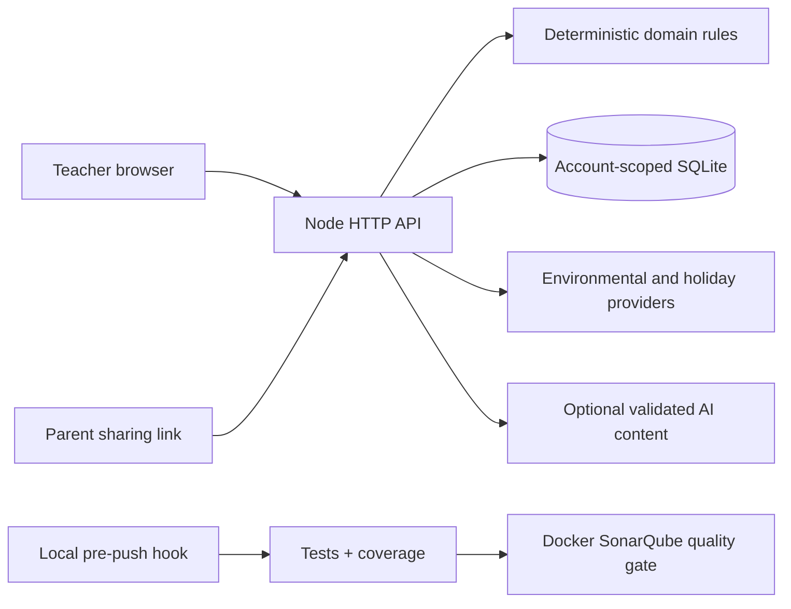

<div align="center">
  
  <h1>Неделко · nedelko</h1>
  <p>Вашата недела во градинка, испланирана. / Your kindergarten week, planned.</p>
  <p><strong>Little discoveries. Thoughtful kindergarten planning.</strong></p>
  <p>A Macedonian and English week planner with indoor alternatives,<br>local air observations, weather forecasts and teacher-reviewed parent notices.</p>
  <p><a href="#quick-start">Quick start</a> · <a href="docs/README.md">Documentation</a> · <a href="docs/architecture/adrs/README.md">Architecture decisions</a> · <a href="docs/development/quality-gates.md">Quality gates</a></p>
</div>

---

## What it does

- **Plan Monday–Friday.** Reuse the kindergarten’s meals and rest times, then create bilingual activities with indoor and outdoor versions. Earlier days remain empty when generating midweek.
- **Adapt to current evidence.** Deterministic PM2.5 and weather checks can move activities indoors. Weather limits are editable logistics preferences.
- **Keep teachers in control.** Edit an activity, review a proposed timetable, and recheck the same morning before approving a parent notice.
- **Share a family view.** Parents follow a revocable link to view the week and submit notes. Teacher accounts own private plans; there is no formal Parent/Teacher RBAC system.
- **Explore without credentials.** Isolated synthetic demos include different seasons, holidays, pollution, stale readings and unavailable sensors. They never overwrite an account’s plan.

> Weekly plans are provisional. Missing or suspect readings mean unknown conditions. PM2.5 screening is not a complete air-quality assessment or medical certification. No message delivery, user study or measured impact is claimed.

## Quick start

### With Node.js

Requires **Node.js 24+**. No build step or server runtime dependencies.

```sh
npm start
```

Open **[127.0.0.1:4173](http://127.0.0.1:4173)** and explore the sample week, or register a kindergarten account. Use `npm.cmd` in Windows PowerShell if `npm` is restricted by execution policy.

### With Docker

Requires Docker Engine/Desktop with Compose v2.24+.

```sh
docker compose up --build -d --wait
```

| Service | Address | Persistence |
| --- | --- | --- |
| Application | [127.0.0.1:4173](http://127.0.0.1:4173) | SQLite in `app_data` |
| SonarQube Community Build | [127.0.0.1:9000](http://127.0.0.1:9000) | Dedicated PostgreSQL and Sonar volumes |

The root Compose stack starts the application. Start Sonar separately with `npm --prefix static-analysis start`. Stop the app with `docker compose down`; named volumes remain. See [Docker operation](docs/operations/docker.md) for resource requirements, ports and backups.

## Optional AI

If `.env` does not already exist, copy [.env.example](.env.example) to `.env` and set `OPENAI_API_KEY` and `OPENAI_MODEL`. Restart the app after changes. Keys stay server-side and are excluded from the image and scanner. Preserve any existing `.env`.

Validated model output supplies educational content; the server owns air-quality arithmetic, scheduling constraints and approval rules. Library fallback is identified under Manage week. Explicit daily-topic requests cannot silently fall back and overwrite an existing week. Demo suggestions use the local library.

## Develop and verify

```sh
npm ci
npm run hooks:install       # required once per clone
npm run verify             # syntax, documentation links, tests, line coverage
```

| Command | Purpose |
| --- | --- |
| `npm test` | Domain, API, SQLite, DOM and tooling regression tests |
| `npm run test:api` | [Postman API collection](docs/development/api-tests.md) against an isolated app; first run `npm --prefix api-tests ci` |
| `npm run test:coverage` | LCOV report; requires **≥91% lines separately for backend and frontend** |
| `npm run check` | JavaScript syntax and local documentation links |
| `npm run gate` | Local checks plus a completed, passing SonarQube quality gate |
| `npm run dev` | Restart the native server when source changes |

The **91% value is an enforced minimum, not a claim about a verified result**. Current successful test-run results are in `coverage/summary.json`; an incomplete or failed test run cannot pass. Coverage includes every authored application JavaScript file, with branches and functions also reported. See [verification status](docs/development/verification-status.md).

### Required before pushing

1. Start SonarQube with `npm --prefix static-analysis start`.
2. Sign in at port 9000 using the initial `admin` / `admin` credentials and change the password. Generate an admin **user token** under **My Account → Security**.
3. Copy [static-analysis/.env.example](static-analysis/.env.example) to `static-analysis/.env`, set `SONAR_TOKEN`, and run `npm run sonar:configure`. This provisions the private project and its quality gate. For routine scans, replace the setup token with a non-admin scanner account’s **user token**, granting Browse and Execute Analysis permissions on the project. Project analysis tokens cannot read the gate configuration on the pinned server. See the [full setup instructions](docs/development/quality-gates.md).
4. Run `npm run gate`. After `npm run hooks:install`, every push of source refs runs the same gate and waits for Sonar’s result.

The hook blocks missing credentials, test failures, insufficient coverage, unavailable SonarQube and failed quality gates. Pushes require a clean working tree and refs pointing to checked-out HEAD, so the checked code matches the pushed code. Hooks are local safeguards; Git can bypass them, so server-side enforcement would require a separate remote policy. [Setup and troubleshooting →](docs/development/quality-gates.md)

## Architecture



**Frontend:** pinned local Preact 10.29.8 + HTM 3.1.1, browser ES modules and CSS. **Backend:** native Node HTTP, crypto and SQLite. **Tests:** `node:test` and development-only `linkedom`. Docker starts the same app without installing runtime packages.

## Documentation

| Read this | For |
| --- | --- |
| [Documentation index](docs/README.md) | The complete documentation map |
| [Architecture & ADRs](docs/architecture/adrs/README.md) | Decisions, tradeoffs and alternatives |
| [Decision basis](docs/architecture/decision-basis.md) | Evidence, freshness and recommendation rules |
| [Local operation](docs/operations/local-development.md) | Accounts, demos, persistence and parent links |
| [Quality gates](docs/development/quality-gates.md) | Coverage, SonarQube and pre-push enforcement |
| [Product research](docs/product/research.md) | Research inputs and possible future work |
| [Sources](docs/reference/sources.md) · [Third-party notices](docs/reference/third-party.md) | Attribution and vendored licenses |
